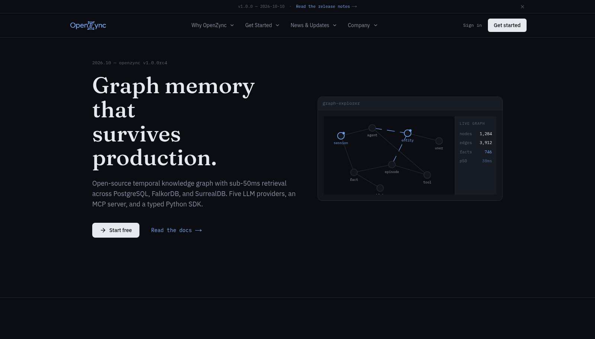

<p align="center"></p>

# OpenZync Landing

Marketing site and blog for the OpenZync memory platform.

<p align="center">
  <a href="./LICENSE"></a>
  
</p>

Next.js App Router site at [openzync.tech](https://openzync.tech), with MDX for the blog and release notes, in an npm workspaces monorepo alongside a shared design system package.

[openzync.tech](https://openzync.tech) · [Docs](https://docs.openzync.tech/en/latest/) · [Live app](https://app.openzync.tech) · [GitHub org](https://github.com/openzync)

<p align="center"></p>

*The openzync.tech hero: positioning line, the graph-explorer panel with node and edge counts, and the two entry points — start free or read the docs.*

## Layout

- `landing/` — the Next.js app: routes in `src/app`, components in `src/components`
- `landing/content/` — MDX source: `blog/` and `changelog/`, read by `src/lib/blog.ts` and `src/lib/changelog.ts`
- `packages/design-system/` — shared UI package (`@openzync/design-system`)
- `netlify.toml` — Netlify build config: base `landing`, publish `.next`

Posts are data, not routes: add `landing/content/blog/<slug>.mdx` with frontmatter and the blog index and `src/app/blog/[slug]` pick it up. Release notes go in `landing/content/changelog/<version>.mdx` and render at `/changelog`.

## Getting started

npm workspaces — run installs at the repo root, not inside `landing/`:

```bash
npm install
npm run dev -w landing
```

Open `http://localhost:3000`.

## Deploy

Netlify builds from `netlify.toml` on push. `npm run build` in the `landing` workspace produces the `.next` output Netlify publishes.

## Related repositories

- [openzync-core](https://github.com/openzync/openzync-core): the backend the product runs on
- [openzync-frontend](https://github.com/openzync/openzync-frontend): admin dashboard at [app.openzync.tech](https://app.openzync.tech)
- [openzync-docs](https://github.com/openzync/openzync-docs): documentation at [docs.openzync.tech](https://docs.openzync.tech/en/latest/)

## License

MIT — see [LICENSE](./LICENSE). Contributions follow the org-wide [contributing guide](https://github.com/openzync/.github/blob/main/CONTRIBUTING.md).

If the site or the blog posts helped you, star the repo.
